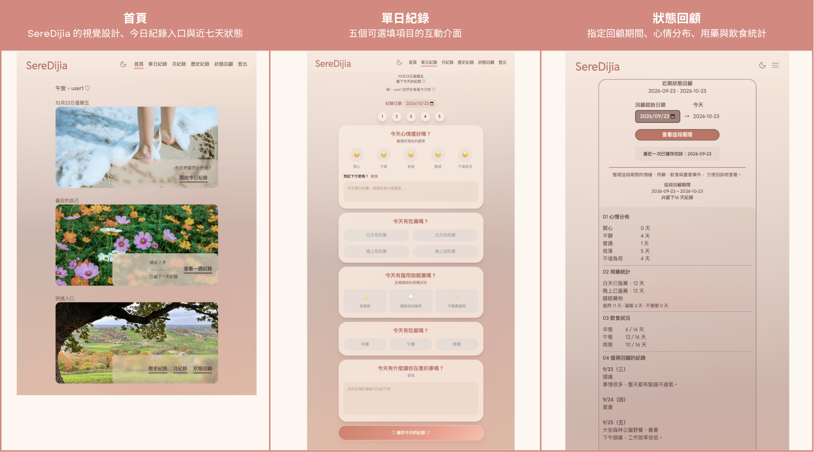
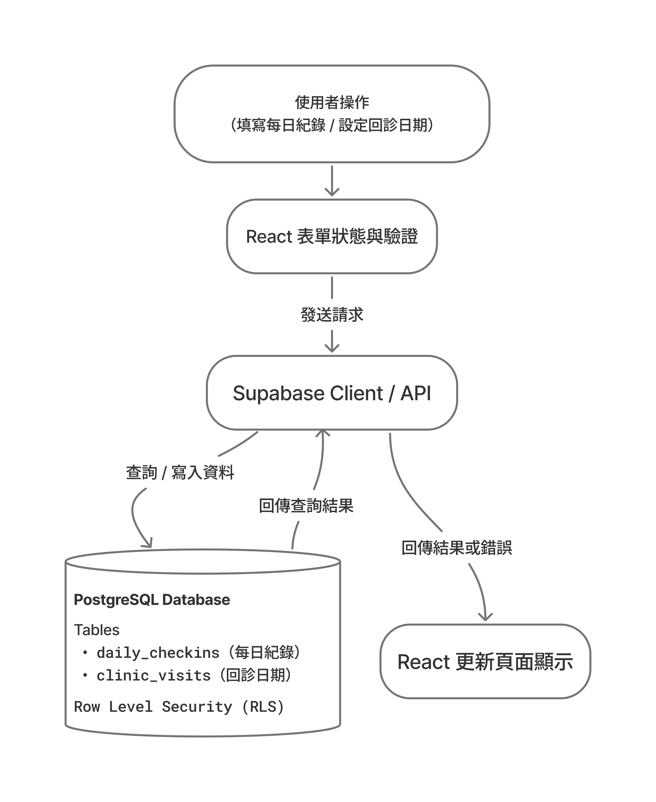

#### 01 專案介紹

SereDijia 是一款協助使用者記錄每日身心狀態的 Web App，透過簡單的每日紀錄、週／月回顧與自訂日期區間統計，幫助使用者觀察生活狀態的變化，並在回診或諮商前整理值得討論的資訊。

-  為什麼設計這個產品？
開發 SereDijia，是因為我發現每次回診前，要回想過去一段時間的情緒、生活事件與用藥狀況並不容易。我也試過其他紀錄 App，但有些操作流程較為繁瑣，需要花費較多時間填寫。

-  如何解決？
考量到使用者在身心狀態不佳時，可能缺乏完成繁瑣紀錄的精力，因此我將每日紀錄簡化為五個可選填項目，並以點選操作為主，減少文字輸入的負擔，降低持續記錄的門檻。

- 帶來什麼價值？
App 會將每日紀錄整理成近一週、每月及指定期間的統計回顧，幫助使用者了解自己的狀態變化，並在回診或諮商前快速整理重要資訊。

---

#### 02 網站連結與截圖



- [SereDijia Live Website](https://seredijia-mjh.vercel.app/)


- [影片：第一支：主要操作流程](https://www.youtube.com/watch?v=ayjDwfOoeVk)
  - 註冊登入、建立紀錄、切換日期、查看統計，及儲存回診日期的過程。
- 影片：第二支：操作細節與使用體驗
  - 「未登入時會導向登入頁」、「取消編輯不儲存變更」等細節。
- 試用帳號： 信箱：seredijiauser@gmail.com 密碼：qwert678

---

#### 03 核心功能

- 每日紀錄 Daily Check-in — 記錄每日心情、用藥、飲食及生活事件，支援新增、編輯、刪除。
- 歷史紀錄 Calendar History — 透過月曆瀏覽歷史紀錄，快速查看或補登指定日期。
- 週回顧 Weekly Reviews — 回顧最近七天的情緒與生活紀錄。
- 月回顧 Monthly Reviews — 統計指定月份的心情分布、用藥、飲食及重要事件。
- 狀態回顧（自訂期間）Custom Period Review — 自訂回顧起始日期，並儲存回診日期，方便整理兩次回診間的狀態。
- 帳號驗證與資料存取保護 Authentication — 使用 Supabase Auth 與 Row Level Security 保護個人紀錄，支援使用者註冊、登入及個人資料存取保護。

---

#### 04 使用技術

前端開發與建構
- Vite: v8.0.12 – 專案建構工具
- React: v19.2.6 – 前端框架

表單處理
- Formik v2.4.6 – 表單狀態管理
- Yup v1.6.1 – 表單驗證

介面元件與圖示
- react-icons v5.7.0 – icons
- react-calendar v6.0.1 – 月曆

後端 / 資料庫
- Supabase v2.114.0 – 後端服務與資料庫

---

#### 05 技術亮點

| 技術亮點              | 可以說明的工程能力 |
| ------------------- | --------------- |
| Supabase Auth + RLS | 使用者身份驗證、資料存取權限設計 |
| 共用統計函式         | 將週期不同的統計需求整理成可共用函式 |
| 日期區間查詢         | 依日期範圍查詢資料，處理非同步載入狀態 |
| 錯誤處理與空狀態      | 處理查詢失敗、刪除失敗、空資料與重複儲存等情境 |

**1. 身分驗證與資料存取保護**

使用 Supabase Auth 管理使用者註冊、登入與身分驗證，並透過 Row Level Security（RLS）限制資料存取權限。

針對 `daily_checkins` 與 `clinic_visits` 設定存取政策，確保登入使用者只能讀取、新增、修改及刪除自己的紀錄。

**2. 日期區間查詢與統計**

依照不同回顧需求，查詢指定日期範圍內的紀錄，並整理心情、用藥及飲食資料。

支援最近七天、指定月份及自訂期間的狀態回顧，讓使用者從每日紀錄中觀察一段時間的變化。

**3. 錯誤處理與使用者體驗

針對實際操作情境設計不同的介面狀態，包括：

- 資料載入中與查詢失敗
- 指定期間沒有紀錄
- 刪除失敗時保留原始資料並顯示錯誤訊息
- 避免重複儲存相同的回診日期
- 未登入時引導使用者登入，成功後返回原本頁面

透過這些處理，降低操作失敗造成的資料遺失風險，並讓使用者清楚了解目前的系統狀態。

---

#### 06	資料流程

SereDijia 使用 React 管理前端介面與使用者操作，並透過 Supabase 進行身分驗證及資料儲存。



**每日紀錄資料流程**

1. 使用者在每日紀錄表單中選擇心情、用藥及飲食狀態，並可填寫文字備註。
2. React 管理表單資料，使用 Formik 與 Yup 處理表單狀態及驗證。
3. 使用者提交紀錄時，前端將資料傳送至 Supabase。
4. PostgreSQL 透過 Row Level Security（RLS）政策，限制登入使用者只能存取自己的資料。
5. 操作成功後，前端更新顯示的紀錄；若操作失敗，則顯示對應的錯誤訊息。

**回顧統計資料流程**

週、月及自訂期間回顧會依照指定日期範圍取得使用者紀錄，再將資料整理為心情分布、用藥及飲食統計，呈現在對應的回顧頁面。

---

#### 07 開發挑戰與解決方式

**刪除失敗時的狀態處理**

**遇到的問題**

在開發每日紀錄的刪除功能時，需要考慮網路連線異常或資料庫操作失敗的情境。

如果刪除請求失敗，但前端仍清空表單，使用者可能誤以為紀錄已成功刪除，造成畫面與資料庫狀態不一致。

**解決方式**

- 新增刪除確認對話框，避免使用者誤觸。
- 使用者確認後，才執行 Supabase 刪除操作。
- 刪除成功後，更新介面狀態。
- 若刪除失敗，顯示錯誤訊息並保留原始紀錄。
- 透過模擬離線情境，驗證刪除失敗時的處理方式。

**改善結果**

確保刪除失敗時，不會錯誤清除使用者正在查看的紀錄，提升資料操作的可靠性與使用者體驗。

---

#### 08 本地安裝方式

### 環境需求

- Node.js
- npm
- Supabase project

### 安裝步驟

1. 複製專案並進入資料夾

   ```
   git clone https://github.com/MiJouHsieh/seredijia.git
   cd seredijia
   ```

2. 安裝相依套件

   npm install

3. 在專案根目錄建立 .env 檔案

  ```
   VITE_SUPABASE_URL=your_supabase_url
   VITE_SUPABASE_ANON_KEY=your_supabase_anon_key
  ```

4. 啟動開發伺服器

   `npm run dev`

若要使用完整功能，需先完成 Supabase 資料庫與存取權限設定。目前專案尚未提供資料庫初始化腳本。

---
